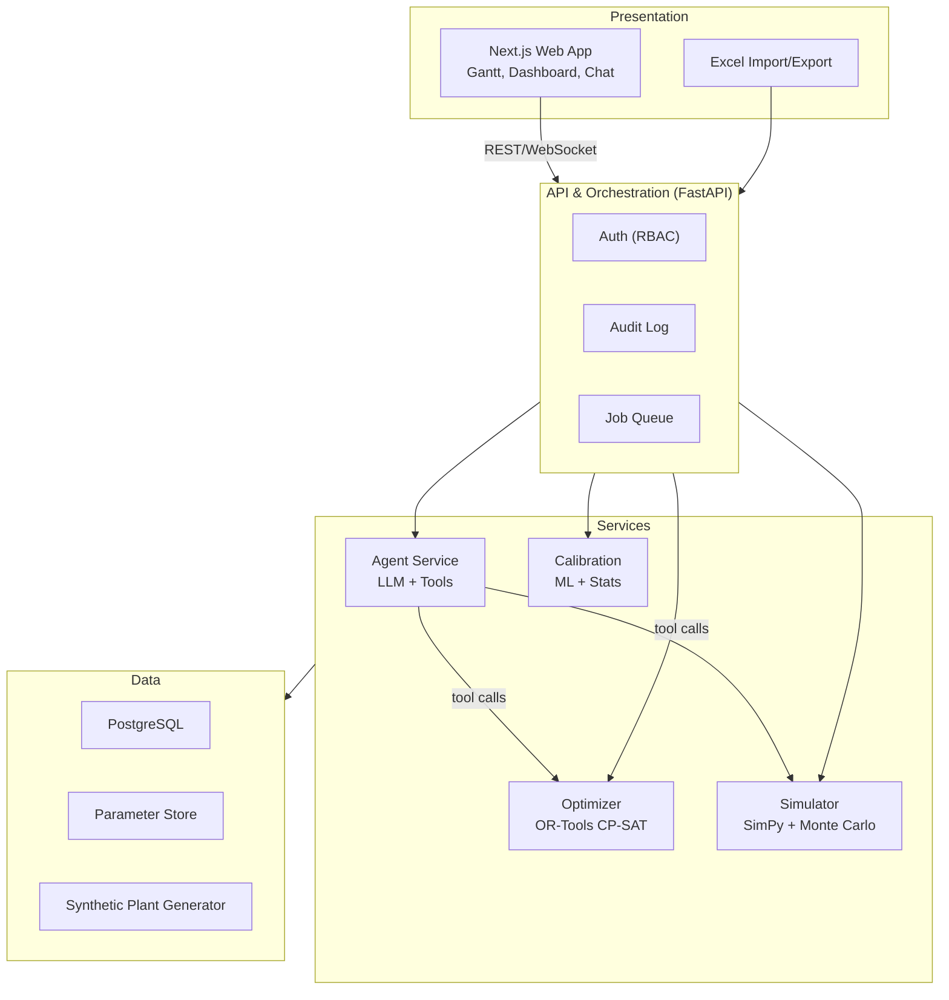

# harness.md — Cadence

> AI-powered production planning & capacity optimization copilot for press-based manufacturing.
> Repo: https://github.com/Precise-Goals/Cadence.git

## 1. Problem Statement

Planners in high-mix press-based manufacturing (molding, stamping) cannot trust production plans because input data is stale, constraints are hidden, disruptions are constant, and plans are never stress-tested. Cadence learns real shop-floor behaviour from actuals, builds constraint-feasible schedules, stress-tests them with simulation, and lets planners ask "what if?" in plain language — with every answer explained and quantified. It sits beside the planner's Excel and ERP, not replacing them.

Full problem statement: [docs/raw.md](../docs/raw.md)

## 2. Goals & Non-Goals

### Goals
- G1: Self-calibrating parameters — learn cycle times, yields, setup times from actuals; flag drift
- G2: Constraint-feasible scheduling — CP-SAT optimizer covering press/mold compatibility, changeovers, due dates, maintenance
- G3: Robustness-scored plans — Monte Carlo simulation scoring every plan for survivability
- G4: Explainable what-if copilot — NL interface calling verified solvers, with constraint-level traces
- G5: Excel-native import/export — planners keep their format
- G6: Data-quality-first — dirty data handled as a feature with confidence tags

### Non-Goals
- NG1: Replacing ERP or MES systems
- NG2: Real-time MES integration (beyond file-based ingestion)
- NG3: Multi-plant orchestration (v1 is single-plant)
- NG4: Automatic plan execution (always HITL approval gate)
- NG5: Mobile app
- NG6: Full APS suite feature parity

## 3. Users & Use Cases

| User | Primary Use Case |
|---|---|
| Production planner/scheduler | Re-plan after disruption in minutes, compare options with KPI trade-offs |
| Plant manager | View robustness scores, bottleneck warnings, OTD risk |
| Supply chain/demand planner | Load-vs-capacity view under demand scenarios |
| Industrial engineer/IT | Parameter drift reports, data quality dashboards |

## 4. Requirements

| ID | Statement | Priority | Source |
|---|---|---|---|
| REQ-001 | Ingest ERP-style exports, MES logs, and Excel sheets through schema adapters | MUST | raw.md §4 M1 |
| REQ-002 | Run data-quality pipeline: missing values, unit mismatches, outliers, duplicates | MUST | raw.md §4 M1 |
| REQ-003 | Learn actual parameters (cycle time, yield, setup time) from history with confidence intervals | MUST | raw.md §4 M1 |
| REQ-004 | Produce Parameter Drift Report comparing ERP vs observed values | MUST | raw.md §4 M1 |
| REQ-005 | CP-SAT optimizer: press/mold compatibility, changeovers, due dates, maintenance windows, shift calendars | MUST | raw.md §4 M2 |
| REQ-006 | Configurable objectives: weighted lateness, makespan, changeover time, overtime, WIP | MUST | raw.md §4 M2 |
| REQ-007 | Warm-start and incremental re-solve for fast re-planning | SHOULD | raw.md §4 M2 |
| REQ-008 | SimPy discrete-event simulation using calibrated stochastic parameters | MUST | raw.md §4 M3 |
| REQ-009 | Monte Carlo robustness scoring: OTD%, P90 lateness, bottleneck probability, fragility | MUST | raw.md §4 M3 |
| REQ-010 | NL what-if agent: parse intent → structured scenario → tool calls → ranked options | MUST | raw.md §4 M4 |
| REQ-011 | KPI delta table and trade-off explanation for each option | MUST | raw.md §4 M4 |
| REQ-012 | Constraint-level explainability: trace decisions to binding constraints | MUST | raw.md §4 M4 |
| REQ-013 | Human-in-the-loop approval gate for every published plan change | MUST | raw.md §4 M4 |
| REQ-014 | Audit log for all plan changes | MUST | raw.md §4 M4 |
| REQ-015 | Feedback loop: approved plans vs actuals update calibration | SHOULD | raw.md §4 |
| REQ-016 | Synthetic Plant Generator for development and evaluation | MUST | raw.md §7 T1 |
| REQ-017 | Web UI: Gantt chart, KPI dashboard, chat interface, scenario comparison | MUST | raw.md §6 |
| REQ-018 | Excel import/export for plans | MUST | raw.md §5 |
| REQ-019 | RBAC and authentication | SHOULD | raw.md §6 |
| REQ-020 | LLM gateway: OpenRouter + Sarvam AI + local Ollama | MUST | raw.md §8.5 |
| REQ-021 | No LLM-generated numbers — all KPIs from solver/simulator/database | MUST | raw.md §8.3 |
| REQ-022 | Agent evaluation harness: 100+ disruption phrasings with expected scenarios | SHOULD | raw.md §8.3 |
| REQ-023 | Docker-based deployment, cloud-agnostic | SHOULD | raw.md §6.1 |
| REQ-024 | On-prem mode with local LLM (factory data stays on-site) | COULD | raw.md §6.1 |

## 5. Acceptance Criteria

| ID | REQ | Given/When/Then |
|---|---|---|
| AC-001-a | REQ-001 | Given a CSV/Excel file with order data, When uploaded through the ingestion adapter, Then all valid rows are parsed and stored with schema validation |
| AC-001-b | REQ-001 | Given a file with mixed delimiters and encoding, When ingested, Then errors are reported per-row without crashing |
| AC-002-a | REQ-002 | Given a dataset with 5% missing values, 2% unit errors, and 1% duplicates, When DQ pipeline runs, Then each defect type is detected with ≥90% precision |
| AC-003-a | REQ-003 | Given 300+ actual cycle-time records for a part/press pair, When calibration runs, Then the fitted distribution's MAPE vs ground truth is ≤15% |
| AC-004-a | REQ-004 | Given ERP value of 12.0s and observed median of 14.6s, When drift report runs, Then the drift is flagged with statistical significance |
| AC-005-a | REQ-005 | Given 30 presses, 200 jobs, compatibility and changeover constraints, When solver runs with 30s time limit, Then a feasible schedule is produced |
| AC-005-b | REQ-005 | Given the same instance, When a mold-incompatible assignment is forced, Then the solver rejects it |
| AC-006-a | REQ-006 | Given two objective weights (minimize lateness vs minimize changeovers), When solved, Then the solutions differ measurably on those KPIs |
| AC-008-a | REQ-008 | Given a plan and stochastic parameters, When 100 simulation runs execute, Then OTD distribution is reported with mean and P10/P90 |
| AC-009-a | REQ-009 | Given two plans (A: optimized, B: EDD baseline), When both are simulated, Then A's robustness score is higher on ≥2 metrics |
| AC-010-a | REQ-010 | Given "Press 4 is down for 2 days", When parsed by the agent, Then a structured disruption scenario is produced with machine_id, duration, and start_time |
| AC-010-b | REQ-010 | Given an ambiguous input "make it faster", When parsed, Then a clarifying question is returned instead of a scenario |
| AC-011-a | REQ-011 | Given a disruption scenario with 3 options, When compared, Then each option shows OTD%, total tardiness, changeover delta |
| AC-012-a | REQ-012 | Given a moved job in the optimized plan, When explanation is requested, Then the binding constraint(s) are listed with resource IDs |
| AC-013-a | REQ-013 | Given a recommended plan change, When displayed, Then the planner must click "Approve" before it is committed |
| AC-016-a | REQ-016 | Given generator config (30 presses, 200 jobs), When run, Then a complete synthetic dataset is produced with known ground truth |
| AC-017-a | REQ-017 | Given a schedule, When viewed in the UI, Then a Gantt chart renders with per-press rows and job blocks |
| AC-017-b | REQ-017 | Given KPIs, When dashboard loads, Then OTD%, utilization, changeover time, and WIP are displayed |
| AC-018-a | REQ-018 | Given a schedule, When exported to Excel, Then it opens in Excel with correct columns and formatting |
| AC-020-a | REQ-020 | Given OPENROUTER_API_KEY set, When agent is invoked, Then it uses OpenRouter; given OLLAMA_HOST set and no cloud key, Then it uses Ollama |
| AC-021-a | REQ-021 | Given any agent response with KPI numbers, When traced, Then every number originates from a tool call output, not LLM generation |

## 6. Architecture & Tech Stack

### Stack
| Layer | Choice |
|---|---|
| Frontend | Next.js 16.4 (App Router), JSX, Tailwind CSS 4, Zod, Recharts, Gantt library |
| Backend | FastAPI (Python), Pydantic, SQLAlchemy |
| Optimization | OR-Tools CP-SAT |
| Simulation | SimPy |
| ML | scikit-learn, LightGBM, statsmodels, SciPy |
| LLM | Vercel AI SDK → OpenRouter / Sarvam AI / Ollama |
| Database | PostgreSQL (Neon/Supabase) |
| DevOps | Docker, GitHub Actions, Vercel (web), Cloud Run (solver) |
| Quality | pytest, Pandera, Ruff, ESLint, pre-commit |
| JS Package Manager | bun 1.4.4 |
| Python Package Manager | uv |

### Architecture diagram



ADR links: `docs/adr/` (created as decisions arise)

## 7. Project Structure

```
cadence/                          # repo root = Next.js web app
├── src/app/                      # Next.js App Router pages
│   ├── (dashboard)/              # KPI dashboard routes
│   ├── (planner)/                # Gantt + planning routes
│   ├── (chat)/                   # What-if copilot chat
│   ├── api/                      # Next.js Route Handlers (agent, LLM gateway)
│   └── layout.js, page.js
├── src/components/               # React components (Gantt, KPI cards, chat)
├── src/lib/                      # Client utilities, API client, Zod schemas
├── services/                     # Python packages (uv workspace)
│   ├── optimizer/                # OR-Tools CP-SAT model
│   ├── simulator/                # SimPy + Monte Carlo
│   ├── calibration/              # Parameter learning, drift detection
│   ├── synthetic_plant/          # Synthetic Plant Generator
│   └── api/                      # FastAPI app
├── eval/                         # Baselines, scenarios, agent regression set
├── docs/                         # Problem statement, plan, ADRs, memory
├── harness/                      # Harness engineering files
├── infra/                        # Dockerfiles, Compose, CI, Cloud Run config
├── scripts/                      # Harness scripts (check, guard, breaker)
├── tests/                        # Harness tests + product tests
├── public/                       # Static assets
├── package.json                  # bun
├── pyproject.toml                # uv workspace root
├── jsconfig.json
├── next.config.mjs
├── eslint.config.mjs
└── README.md
```

## 8. Commands

| Purpose | Command |
|---|---|
| install (JS) | `bun install` |
| install (Python) | `uv sync` |
| dev (web) | `bun run dev` |
| dev (API) | `cd services/api && uv run uvicorn main:app --reload` |
| lint (JS) | `bun run lint` |
| lint (Python) | `uv run ruff check .` |
| format (JS) | `bunx prettier --write .` |
| format (Python) | `uv run ruff format .` |
| typecheck | `bunx tsc --noEmit -p jsconfig.json` (with @ts-check files) |
| unit test (JS) | `bunx vitest run` |
| unit test (Python) | `uv run pytest services/ -x` |
| integration test | `uv run pytest tests/integration/ -x` |
| build | `bun run build` |
| harness self-test | `python scripts/check_harness.py && uv run pytest tests/harness/` |

## 9. Coding & Testing Standards

### JavaScript/JSX
- JSX with JSDoc types (`/** @type {import('...').Type} */`)
- `@ts-check` on all files in `src/lib/` and `src/components/`
- Zod schemas for all API request/response validation
- ESLint 9 + eslint-config-next
- Prettier for formatting
- Component naming: PascalCase. Files: kebab-case
- No `any` in JSDoc types; no `eslint-disable` without JIRA/issue reference
- Imports: absolute via jsconfig aliases (`@/components/...`)

### Python
- Python 3.11+
- Ruff for lint + format (replaces black, isort, flake8)
- Pydantic v2 for all data models
- Type hints on all function signatures
- Docstrings (Google style) on all public functions
- No `# noqa` without issue reference

### Testing
- Test pyramid: many unit, some integration, few e2e
- Tests-first: red run precedes implementation
- Unit tests: fast (<1s), hermetic, deterministic (seed, freeze time, no network)
- Naming: `test_<unit>_<behavior>`
- Coverage floor: 80% on changed lines
- No mocks of the unit under test
- Forbidden: deleting/skipping/weakening tests, snapshot blind-updates, catch-and-swallow

### Git
- Conventional commits: `feat|fix|chore|docs|test|refactor(scope): message`
- One logical change per commit
- Branch naming: `feat/T-XXXX-short-desc`, `fix/T-XXXX-short-desc`, `lane/T-XXXX-lane-name`
- Squash merge to main
- No force push to main

## 10. Tools, APIs & MCP Servers

### Tool inventory
| Tool | Kind | Purpose | Allowed Roles | Approval |
|---|---|---|---|---|
| file_read | builtin | Read any file | all | auto |
| file_write | builtin | Write to owned paths | role-scoped | auto (guard) |
| bash | bash | Run commands | builder, test-author, qa, security | auto (sandbox) |
| git | bash | Version control | orchestrator, builder | auto |
| web_fetch | api | Fetch docs/APIs | po-spec, tech-lead, librarian | auto |
| package_install | bash | Add dependencies | builder | confirm |
| deploy | bash | Deploy to production | — | forbidden |
| bun | bash | JS package manager | builder | auto |
| uv | bash | Python package manager | builder | auto |
| or-tools | python | Constraint solver | builder (optimizer lane) | auto |
| simpy | python | Simulation engine | builder (simulator lane) | auto |

### MCP Servers (from docs/mcp.md)
Preset: `web-app` + `data-pipeline` hybrid
- `context7` (core): version-specific library docs
- `github` (core): PRs, issues, CI status
- `semgrep` (core): SAST + secrets scan
- `playwright` (frontend): E2E, ARIA snapshots
- `sequential-thinking` (optional): reasoning scratchpad

## 11. Autonomy & Approval Matrix

| Action | Approval |
|---|---|
| Read any file in repo | Auto |
| Write within role allow-list | Auto |
| Run harness commands (§8) | Auto |
| Add JS dependency | Confirm |
| Add Python dependency | Confirm |
| Delete files | Confirm |
| Database migrations | Confirm |
| Deploy | Forbidden |
| Push to main | Confirm |
| Network calls (non-allow-listed) | Forbidden |
| Change harness config | Confirm |

## 12. Sprint Plan

| Sprint | Goal | Tasks | Exit Gate |
|---|---|---|---|
| **0 — Scaffold** | Harness exists and self-tests; repo structure ready | Reconcile, scripts, tests, AGENTS.md, IDE adapters, pyproject.toml, services skeleton | G0 green, user approves |
| **1 — Data Foundation** | Synthetic Plant Generator + ingestion + DQ pipeline | T-0001: Generator v1, T-0002: Ingestion adapters, T-0003: DQ pipeline | G0–G4 green, generator produces valid dataset |
| **2 — Calibrate + Plan MVP** | Parameter learning + CP-SAT scheduler + Gantt UI | T-0004: Calibration engine, T-0005: CP-SAT model, T-0006: Gantt component | Full pipeline, baseline vs optimized results |
| **3 — Simulate + Robustness** | SimPy twin + Monte Carlo scoring + scenario engine | T-0007: Simulator, T-0008: Monte Carlo, T-0009: Plan comparison | Robustness metrics, scenario engine works |
| **4 — Agent + Explainability** | NL what-if agent + tool layer + constraint traces | T-0010: Agent service, T-0011: Tool integration, T-0012: Explainability | Agent eval ≥95% parse accuracy |
| **5 — Hardening** | Feedback loop, perf, security, docs, deploy | T-0013: Feedback loop, T-0014: Security audit, T-0015: Docs + README | Release checklist + user sign-off |

## 13. Risks & Mitigations

| Risk | Likelihood | Mitigation |
|---|---|---|
| No real TE data | High | Synthetic generator + public benchmarks |
| Solver too slow at scale | Medium | Rolling horizon, warm starts, time-limited solves |
| LLM hallucination | Medium | Tool-only numbers, schema validation, eval harness |
| Scope creep | High | Strict vertical-slice rule, harness gates |
| Free LLM rate limits | Medium | LLM gateway, record-and-replay for demos |
| JSX no compile-time types | Medium | Zod schemas, JSDoc + @ts-check, contract tests |
| Serverless limits for solver | Medium | Hybrid hosting, Week-1 spike |

## 14. Assumptions

| ID | Statement | Date | Status |
|---|---|---|---|
| A-001 | Target plant is TE-like: injection molding + stamping presses | 2026-11-17 | Unvalidated |
| A-002 | JSX + JSDoc, no TypeScript | 2026-11-17 | Confirmed |
| A-003 | Flat hybrid monorepo: Next.js at root, Python services alongside | 2026-11-17 | Confirmed |
| A-004 | bun (JS) + uv (Python) | 2026-11-17 | Confirmed |
| A-005 | 1-week sprints, parallelism = 5 | 2026-11-17 | Confirmed |
| A-006 | Vercel (web) + Cloud Run (solver) | 2026-11-17 | From raw.md |
| A-007 | PostgreSQL via Neon/Supabase | 2026-11-17 | From raw.md |
| A-008 | OpenRouter (free models) as primary LLM gateway | 2026-11-17 | From raw.md |

## 15. Open Questions

_(Empty — all questions resolved through interview and raw.md)_

## 16. Definition of Done

A task is done when:
- [ ] Artifacts 01–08 exist and every handoff validated
- [ ] G0–G4 pass with logged evidence
- [ ] Every AC has ≥1 passing test or recorded evidence
- [ ] No new lint/type warnings; no skipped tests; coverage ≥ 80% on changed lines
- [ ] Reviewer: 0 BLOCKER/MAJOR · Security: 0 high/critical · Docs updated
- [ ] Guard clean; no breaker tripped; no unresolved open questions
- [ ] state.json, logs, and lessons.md updated; commit follows git standards
- [ ] AGENTS.md still accurate

## 17. Glossary

See [docs/memory/glossary.md](../docs/memory/glossary.md)
