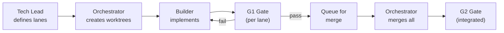

<!-- generated-by: harness v1 | source: harness.md -->

# Parallel Lanes

## Overview

Parallel lanes allow multiple builders to work on the same task simultaneously without conflicts. Each lane operates in isolation with its own branch and worktree, touching only the files it owns.

## Rules

### 1. Isolation via Git Worktrees

Each lane uses its own **git worktree** and **branch**:

```
git worktree add ../worktrees/T-XXXX-solver-engine lane/T-XXXX-solver-engine
git worktree add ../worktrees/T-XXXX-api-routes    lane/T-XXXX-api-routes
git worktree add ../worktrees/T-XXXX-ui-components  lane/T-XXXX-ui-components
```

- Worktrees are created from the task's base branch.
- Each worktree is a fully independent working directory.
- Builders work in their worktree without affecting other lanes.

### 2. Ownership Map Is the Lock Source

> [!IMPORTANT]
> The **Tech Lead's ownership map** in `03-plan.md` is the single source of truth for which files each lane may touch.

Example ownership map from `03-plan.md`:

```json
{
  "lanes": {
    "solver-engine": {
      "owner": "builder-solver",
      "paths": [
        "services/solver/src/**",
        "services/solver/tests/**"
      ]
    },
    "api-routes": {
      "owner": "builder-api",
      "paths": [
        "app/api/solver/**",
        "app/api/forecast/**"
      ]
    },
    "ui-components": {
      "owner": "builder-ui",
      "paths": [
        "components/schedule/**",
        "components/capacity/**",
        "app/(routes)/schedule/**"
      ]
    }
  }
}
```

### 3. No Path Overlap

> [!CAUTION]
> Two lanes may **never** own the same path. If the ownership map contains overlapping paths, the Tech Lead must resolve the conflict before builders begin work.

Validation:
- The Orchestrator checks all lane path sets for intersection before starting Phase 2.
- If overlap is detected, the task is returned to the Tech Lead with a `needs-info` status.

### 4. Concurrency Cap

The maximum number of parallel lanes is defined in `budgets.json`:

```json
{
  "concurrency_cap": 5
}
```

- If a task requires more than 5 lanes, additional lanes **queue** and execute as active lanes complete their G1 gate.
- The Orchestrator manages the queue in FIFO order.
- Lane priority can be overridden by the Tech Lead for critical-path work.

### 5. Lane Gate (G1)

Each lane must independently pass **G1** before its code is eligible for merge:

| Check | Requirement |
|-------|-------------|
| Lint (G0) | Zero warnings in lane-scoped files |
| Unit tests | All lane-scoped tests pass |
| Integration tests | Lane-scoped integration tests pass |
| Coverage | ≥ 80% on changed lines |
| Handoff contract | Valid `handoff-builder-<lane>-to-orchestrator.json` |
| Files touched | All within ownership map bounds |

### 6. Merge Order

After all lanes pass G1:

1. Orchestrator merges lanes into the task branch in dependency order (defined in `03-plan.md`).
2. If merge conflicts arise, the conflicting lane's builder resolves them.
3. After all lanes are merged, the full test suite runs (**G2**).

## Lane Lifecycle



## Shared Dependencies

When multiple lanes depend on shared code (e.g., utility functions, type definitions):

1. **Extract to a shared module** owned by a dedicated lane or the Tech Lead.
2. The shared lane completes and passes G1 **first**.
3. Other lanes rebase onto the merged shared code before continuing.
4. Document the dependency order in `03-plan.md`.

## Troubleshooting

| Issue | Resolution |
|-------|------------|
| Merge conflict at integration | Conflicting lane builder resolves; re-run G1 on resolved code. |
| Lane exceeds file ownership | Orchestrator rejects handoff; builder must coordinate with owning lane. |
| Lane blocked on shared dependency | Escalate to Tech Lead to reorder lane execution. |
| Concurrency cap reached | Lane queues; Orchestrator notifies builder of estimated start time. |
