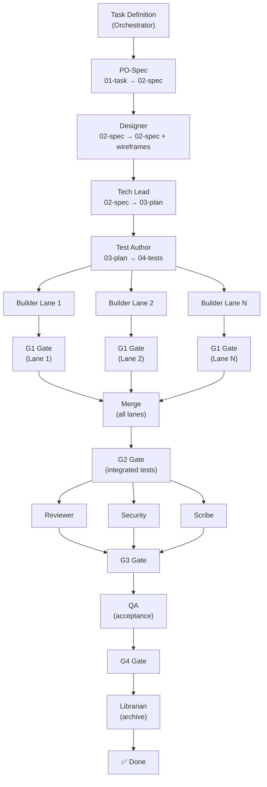

<!-- generated-by: harness v1 | source: harness.md -->

# Pipeline Stage Graph

## Overview

Every task flows through a defined sequence of stages. Each stage is owned by a specific role, produces a specific artifact, and must pass its gate before the next stage begins.

## Stage Diagram

## Stage Reference

| # | Stage | Role | Input Artifact | Output Artifact | Gate |
|---|-------|------|----------------|-----------------|------|
| 1 | Task Definition | Orchestrator | User request | `01-task.md` | — |
| 2 | PO-Spec | Product Owner | `01-task.md` | `02-spec.md` | — |
| 3 | Design | Designer | `02-spec.md` | `02-spec.md` + wireframes | — |
| 4 | Planning | Tech Lead | `02-spec.md` | `03-plan.md` | — |
| 5 | Test Authoring | Test Author | `03-plan.md` | `04-tests.md` + test stubs | — |
| 6 | Build (parallel) | Builder(s) | `03-plan.md` + `04-tests.md` | `05-code/` | **G1** (per lane) |
| 7 | Merge | Orchestrator | All lane branches | Merged branch | — |
| 8 | Integration Verify | CI | Merged code | Test results | **G2** |
| 9 | Review | Reviewer | Merged code | `06-review.md` | — |
| 10 | Security | Security | Merged code | `06-security.md` | — |
| 11 | Documentation | Scribe | Merged code | `07-docs.md` | — |
| 12 | Review Gate | Orchestrator | Review + Security + Docs | — | **G3** |
| 13 | QA Acceptance | QA | All artifacts | `08-qa.md` | **G4** |
| 14 | Archive | Librarian | All artifacts | `lessons.md`, state update | — |

## Parallelism Rules

### Builder Lanes (Stage 6)

- Builder lanes execute **in parallel** after Test Author completes.
- Each lane works on a disjoint set of files defined by the **ownership map** in `03-plan.md`.
- Lanes are isolated via **git worktrees** — each lane has its own working directory and branch (`lane/T-XXXX-lane-name`).
- Each lane must independently pass **G1** (lint + unit tests for its scope) before proceeding to merge.

### Post-Merge Parallel (Stages 9–11)

- Reviewer, Security, and Scribe run **in parallel** after G2 passes.
- All three must complete before G3 can be evaluated.

### Concurrency Cap

> [!IMPORTANT]
> Maximum **5 parallel lanes** at any time, as defined in `budgets.json`. If more lanes are needed, they queue and execute as slots free up.

## Isolation Model

| Mechanism | Purpose |
|-----------|---------|
| **Git worktrees** | Each builder lane gets its own worktree branched from the task branch. Prevents file conflicts during parallel development. |
| **Ownership map** | The Tech Lead's `03-plan.md` defines which files each lane may touch. The Orchestrator enforces this at G1 via `files_touched` in the handoff contract. |
| **Branch naming** | `lane/T-XXXX-<lane-name>` makes lane branches identifiable and automatable. |

## Gate Definitions

| Gate | Trigger | Checks | Blocks On |
|------|---------|--------|-----------|
| **G0** | Every commit | Lint, format, type-check | Any warning or error |
| **G1** | Lane completion | Lane-scoped unit + integration tests | Any failure; coverage < 80% |
| **G2** | Post-merge | Full test suite on merged code | Any failure |
| **G3** | Post-review | 0 BLOCKER/MAJOR from reviewer; 0 high/critical from security | Any unresolved finding |
| **G4** | Post-QA | Every AC has pass evidence | Any AC without evidence |
